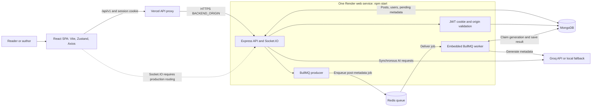
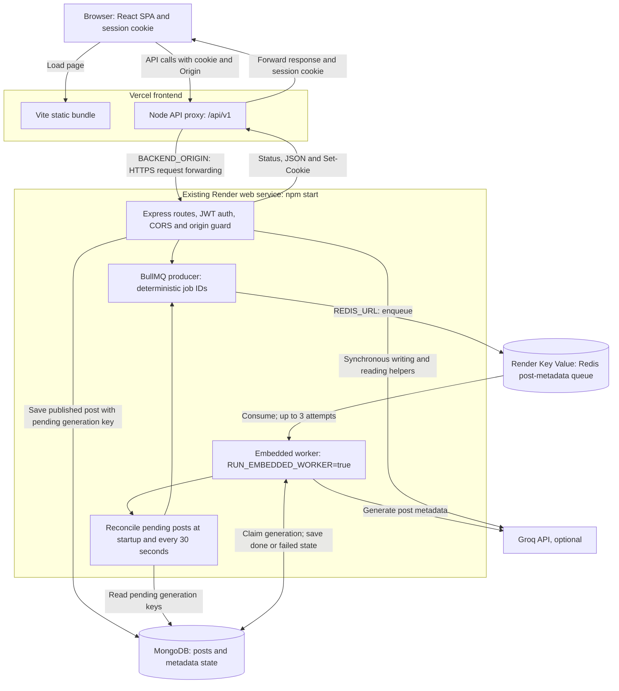
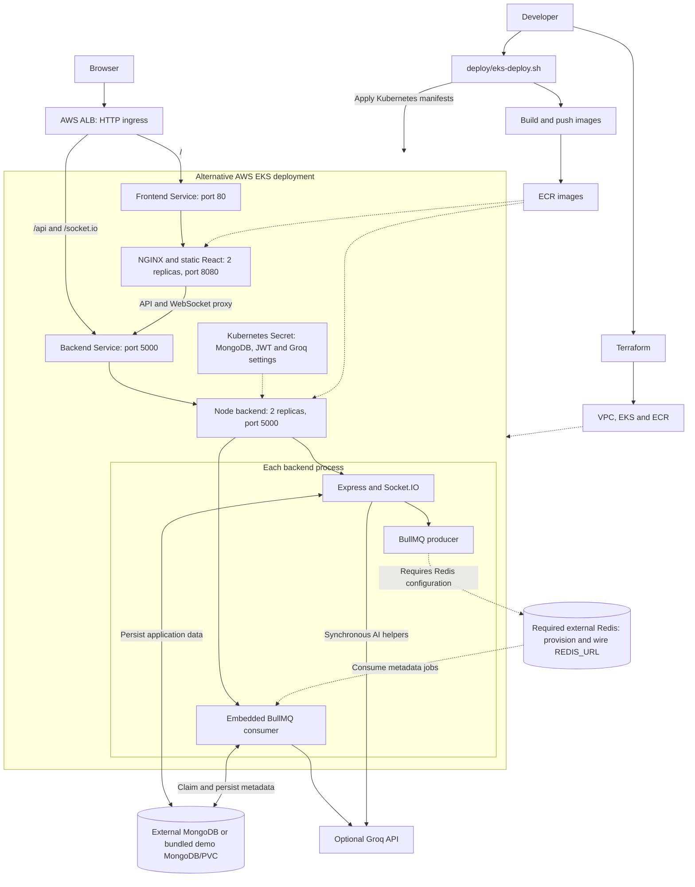
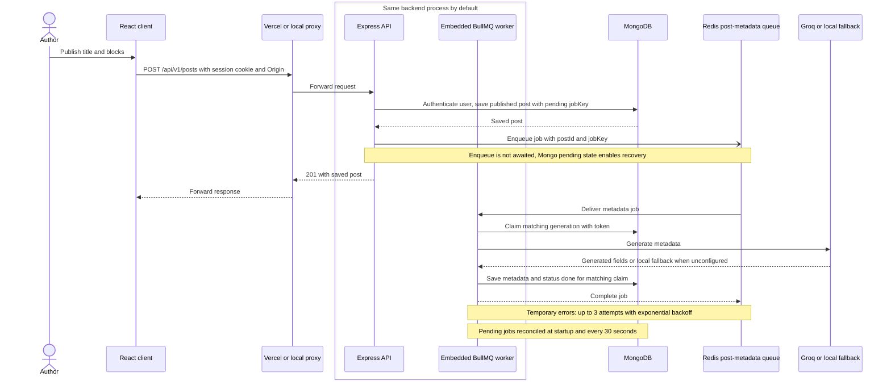

# Inkwell

Inkwell is a publishing and knowledge-sharing application for writing, reading, and discussing structured posts. It combines a React client with an Express API backed by MongoDB, plus optional Groq-powered writing and reading assistance. Posts support interactive blocks and multiple reading modes; the AI layer uses direct prompts and local fallbacks, not a retrieval or agent framework.

## Architecture Overview



Locally, Vite proxies API and Socket.IO requests. In the hosted setup, Vercel rewrites `/api/*` to a Node function using the server-side `BACKEND_ORIGIN` environment variable. Its current rewrite does not proxy WebSocket upgrades, so production Socket.IO needs a separate route or host.

### Published-post summaries

Publishing a post creates a pending AI metadata generation key in MongoDB and enqueues a BullMQ job in Redis. The API returns the saved post without waiting for the model; a worker generates the summary and related metadata, then persists the result in `post.aiMeta`. Opening a post only reads this saved state and never starts another generation. Draft saves do not enqueue metadata. Editing an already-published post queues a new generation. The reader currently does not poll while a page remains open, so a pending result appears after the post is fetched again, such as after reloading or changing reader mode.

## Cloud Deployed Architecture

The project is designed for a cloud deployment pattern where the browser talks to a Vercel-hosted frontend, the frontend uses a server-side proxy for API requests, and the backend runs as a separate Render web service with MongoDB persistence.



This is the currently intended hosted topology for the repository: the frontend is public and stateless, the backend owns authentication and persistence, and the backend origin is configured server-side in the hosting provider.

### Deployment Notes

- `frontend/api/proxy.js` receives `/api/*` traffic on Vercel and forwards it to the server-side `BACKEND_ORIGIN` environment variable.
- `Render` hosts the Express API and the authenticated business logic.
- `npm start` also runs the BullMQ consumer inside the API service by default, so a separate paid Render Background Worker is unnecessary. Set `REDIS_URL` to the existing Render Redis internal URL, and keep MongoDB and Groq settings on the backend service. `QUEUE_WORKER_CONCURRENCY=1` is suitable for a small shared instance.
- To deploy a separate consumer instead, set `RUN_EMBEDDED_WORKER=false` on the API and run `npm run worker` in that separate service. Docker Compose already uses this arrangement.
- When a free Render web service sleeps, its embedded worker pauses too. On wake, it checks for pending jobs at startup and every 30 seconds. Check logs for `post_worker_started` with `mode: "embedded"`, followed by `post_meta_job_started` and `post_meta_job_completed`.
- `FRONTEND_URL` on Render must match the live frontend origin exactly for cookie and CORS checks to pass.
- `BACKEND_ORIGIN` on Vercel should be the HTTPS backend origin, for example `https://your-service.onrender.com`. The proxy also normalizes trailing slashes, surrounding quotes, default HTTPS ports, and an optional `/api` or `/api/v1` suffix. Set it for the deployment's Production or Preview environment and redeploy after changes.
- The diagram above reflects the implemented hosted design. Verify live queue processing after deployment. The Kubernetes/AWS section below describes an alternative hosting option.

### AWS EKS Deployment (Alternative)

AWS EKS is an alternative to Vercel/Render, provisioned with Terraform and `deploy/eks-deploy.sh`.



Terraform provisions the VPC, EKS Auto Mode cluster, and ECR. The deployment script builds and pushes images, then applies Kubernetes resources. Backend credentials, including `MONGO_URI`, come from a Kubernetes Secret. MongoDB is external; Terraform does not create it. `k8s/inkwell.yaml` has a single-replica MongoDB/PVC demo, not a production database. The ALB is HTTP-only; configure TLS before production. The current EKS manifests do not provision Redis or inject `REDIS_URL`; supply both before expecting queue processing to work. The dotted Redis links above show that required configuration.

## Core System Design

**Frontend layer**

- `frontend/src/main.jsx` initializes React; `frontend/src/App.jsx` defines user and guest routes. Pages cover authoring, reading, discovery, profiles, community, and bookmarks.
- TipTap supports authoring; Zustand stores auth state; Axios calls APIs through `frontend/src/utils/api.js`.
- `frontend/api/proxy.js` forwards production API requests. `frontend/vite.config.js` configures local API and Socket.IO proxies.

**API and domain layer**

- `backend/src/index.js` configures Express, Socket.IO, logging, limits, routes, and health; it listens after MongoDB/topic initialization. `backend/src/routes/` covers auth, content, discovery, and AI; protected mutations use auth middleware.

**Identity and persistence layer**

- `backend/src/middleware/auth.js` verifies the HTTP-only `inkwell_session` JWT. Passwords use bcryptjs; the frontend checks `/api/v1/auth/me` on startup.
- `backend/src/models/` defines users, posts, topics, comments, and quiz responses. `backend/src/bootstrap.js` inserts default topics when needed.

**AI and realtime layer**

- `backend/src/services/aiService.js` calls Groq through the OpenAI SDK and normalizes responses with local fallbacks. Published-post metadata runs asynchronously through BullMQ/Redis, with the consumer hosted inside the API by default; other user-requested AI endpoints remain synchronous.
- Socket.IO shares the backend server. REST persists poll votes and post rooms receive `poll-update` events.

## Key Features

- **Publishing and reading:** Posts contain rich blocks and support full, quick-summary, and exam-note modes. Mongoose computes estimated reading time.
- **Community:** Comments, replies, likes, bookmarks, follows, and response posts use protected API mutations.
- **Interactive blocks:** Poll votes persist and broadcast through Socket.IO; a compound index prevents duplicate quiz answers.
- **AI assistance:** Groq optionally powers title/tag suggestions, writing help, rewriting, ELI5, summaries, and comment ranking; local fallbacks cover several operations.
- **Discovery:** Feed, topic, profile, and lexical search use MongoDB; vector retrieval is not implemented.

## Core Application Flow

This sequence shows login followed by protected post publishing; the queue consumer generates metadata asynchronously. It runs inside the API by default and can also run as a separate service.



## Technology Stack

- **Frontend:** React 18, React Router, Vite, CSS Modules, Zustand, Axios, TipTap, Socket.IO Client, Lucide React.
- **Backend:** Node.js, Express, Socket.IO, Mongoose, BullMQ, ioredis, Morgan, CORS, express-rate-limit.
- **Database:** MongoDB; no SQL store or migration framework is configured.
- **Authentication:** bcryptjs password hashing, jsonwebtoken, cookie-parser, HTTP-only session cookie.
- **AI integration:** OpenAI JavaScript SDK pointed at Groq’s OpenAI-compatible API; `GROQ_MODEL` defaults in code to `openai/gpt-oss-20b`. AI is optional.
- **Deployment:** Vercel frontend with Render API, embedded queue consumer, and Key Value Redis; Docker Compose and alternative AWS EKS/EC2 assets are separate deployment paths. The Render Blueprint uses a free web service and a paid Redis plan; reuse your existing Redis for a manual deployment.

RAG, embeddings/vector databases, knowledge graphs, autonomous agents, and supervisor-worker orchestration are **not implemented**.

## Repository Structure

```text
inkwell/
├── backend/
│   ├── src/index.js          # API and process startup
│   ├── src/routes/           # REST endpoints
│   ├── src/models/           # MongoDB schemas
│   ├── src/services/         # AI helpers and fallbacks
│   └── Dockerfile
├── frontend/
│   ├── api/proxy.js          # Vercel server-side API proxy
│   ├── src/pages/             # Application views
│   ├── src/components/        # UI components
│   ├── src/store/             # Client state
│   ├── src/utils/api.js       # API client
│   ├── vercel.json            # Vercel rewrites
│   └── Dockerfile, nginx.conf
├── deploy/                   # EC2 and EKS deployment scripts
├── k8s/                      # Kubernetes manifests
├── terraform/                # AWS infrastructure definitions
├── docker-compose.yml        # Local container stack
└── ARCHITECTURE.md, *_DOCUMENTATION.md
```

## Getting Started

**Prerequisites:** Node.js 20+, npm, and MongoDB. Groq credentials are optional. Commands start from the repository root unless noted.

Install dependencies:

```bash
cd backend && npm ci
cd ../frontend && npm ci
```

Configure the backend:

```bash
cd ../backend
cp .env.example .env
```

Set `MONGO_URI` and a unique `JWT_SECRET` in `backend/.env`. Vite proxies to `localhost:5000`; `VITE_API_URL` can override it. `GROQ_API_KEY` is optional. Never commit populated `.env` files.

Start the backend in one terminal:

```bash
cd backend
npm run dev
```

The API listens on `PORT` (default 5000) after MongoDB and topic setup. Verify `http://localhost:5000/api/v1/health` returns `{"status":"ok","platform":"Inkwell"}`.

Start the frontend in another terminal:

```bash
cd frontend
npm run dev
```

Open `http://localhost:3000`. Vite forwards `/api` and `/socket.io`. From `frontend/`, run `npm run test:proxy` and `npm run build`.

For Vercel/Render environment setup, Docker, Kubernetes, troubleshooting, and the complete API reference, see [DEPLOYMENT.md](DEPLOYMENT.md), [DOCKER_AND_INFRASTRUCTURE.md](DOCKER_AND_INFRASTRUCTURE.md), [TROUBLESHOOTING.md](TROUBLESHOOTING.md), and [API_DOCUMENTATION.md](API_DOCUMENTATION.md).

## Why This Architecture Matters

The SPA, API, persistence, and AI provider have separate responsibilities. Cookie sessions keep JWTs out of JavaScript. Published-post AI work uses a Redis-backed BullMQ queue with MongoDB pending-state recovery. Backend queue and lifecycle tests exist; remaining limitations include free-service sleep, dependency availability, and hosted Socket.IO routing requirements.
