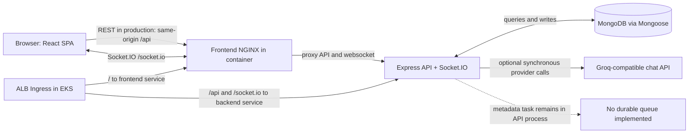
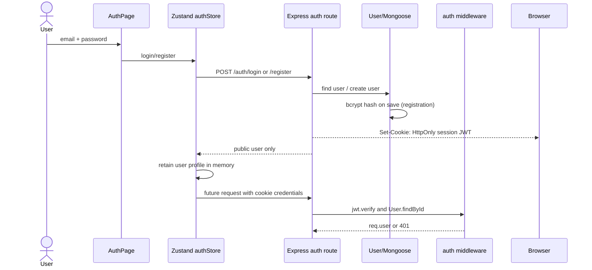
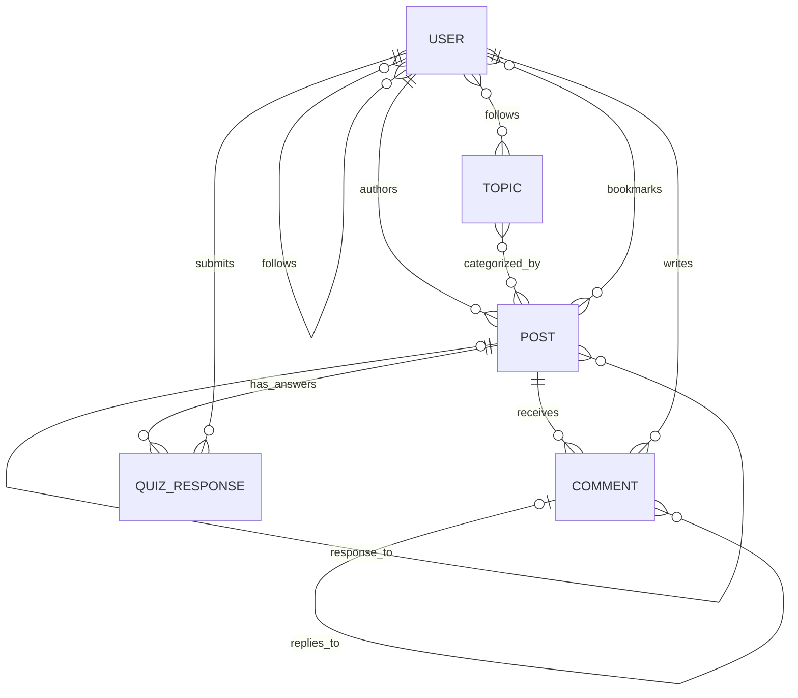
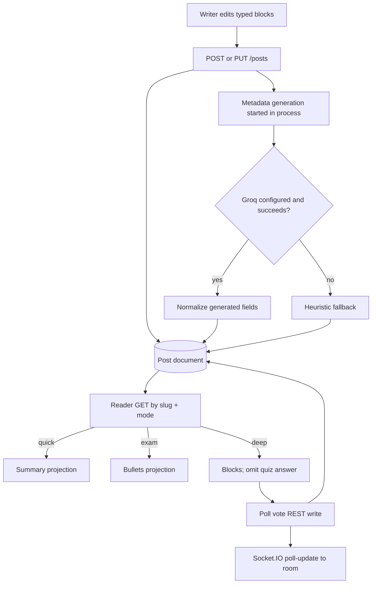
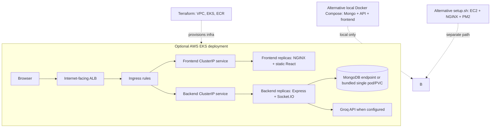

# Part 1: Project Overview And Interview Introduction

## What Inkwell Does

Inkwell is a knowledge-sharing web application. Writers create posts from typed blocks; readers can browse, search, comment, follow authors/topics, bookmark posts, answer quizzes, vote in polls, and choose a full, quick-summary, or exam-style reading mode. Optional AI endpoints produce titles, tags, explanations, summaries, writing assistance, rewrites, and comment ranking. The actual frontend wires a subset of those backend AI endpoints; see [Part 3](03-code-backend-database.md).

The intended users, inferred from routes and features, are writers publishing educational or explanatory content and readers who want different levels of detail or interactive learning. This is a product interpretation, not a user-study result in the repository.

## Five-Minute Explanation

“Inkwell is a web platform for publishing structured knowledge posts and adapting how readers consume them. The frontend is a React 18 single-page app built with Vite, React Router, Zustand, Axios, and CSS Modules. The backend is Node.js and Express, with Mongoose persistence in MongoDB. Authentication uses bcrypt-hashed passwords and seven-day JWTs. Posts contain typed blocks such as paragraphs, headings, code snippets, quizzes, polls, and callouts. REST endpoints handle durable operations, while Socket.IO sends poll updates to clients in a post room.

The main content model is intentionally centered on the post. The `Post` schema embeds blocks and small poll/quiz aggregates, while authors, topics, comments, and quiz responses are referenced or stored separately. On publish, the API saves the post and returns promptly; AI metadata generation runs afterward. The AI service uses the OpenAI SDK against a Groq-compatible endpoint and includes heuristic fallbacks, so content creation does not strictly depend on the provider.

The interesting engineering choices are the flexible block schema, shaping the same post into several reader modes, and combining request-response APIs with realtime poll notifications. The main limitations I would address before production are security around HTML and runnable code, input/ownership validation, asynchronous job durability, concurrency-safe engagement updates, and multi-replica coordination for sockets and rate limits. I don’t have verified performance measurements, so I’d measure query latency, database load, and AI queue delay before making capacity claims.”

### Likely follow-up answers

- **Why build it?** “I wanted to make publishing and reading more adaptive than a conventional article page. The block model supports interactive content, and reading modes let the same post serve a quick overview, a full read, or revision notes.”
- **Most challenging part?** “A defensible challenge is keeping one content model useful for editing, storing, and presenting several block types. I’d explain the schema/reader shaping and acknowledge that server-side block validation is still needed. Only claim personal ownership of this work if it is true.”
- **Technical decisions?** “The repository uses MongoDB documents for posts, REST for durable operations, Socket.IO for poll notifications, and asynchronous AI metadata generation. I can explain their current trade-offs without claiming the codebase proves why each was originally selected.”
- **What would you improve?** “First sandbox or remove executable code and sanitize/render untrusted content safely. Then add request schemas and atomic vote/like handling, move AI work to a durable queue, and add automated tests and monitoring.”
- **What did you learn?** “A feature that works on one process can fail under concurrency or multiple replicas. Database atomicity, input validation, and trust boundaries matter just as much as the happy-path UI.”

## Stack Inventory

| Area | Verified implementation | Notes |
|---|---|---|
| UI | React 18, React DOM, Vite, React Router 6, Zustand, CSS Modules | Vite port 3000; no proxy is configured in `vite.config.js`. |
| HTTP/client | Axios | `utils/api.js` appends `/api/v1`, sends cookies with `withCredentials`, and clears in-memory auth on 401. |
| UI utilities | Lucide React, react-hot-toast, date-fns | Present in frontend package manifest. |
| Realtime | Socket.IO server/client | Poll updates only; no Redis adapter is present. |
| API/runtime | Node.js 20, Express 4 | CommonJS backend, mounted at `/api/v1`. |
| Persistence | MongoDB with Mongoose 8 | Schema indexes and hooks described in Part 3. |
| Auth | jsonwebtoken, bcryptjs | JWT expires in seven days; bcrypt cost 12 in user pre-save hook. |
| AI | OpenAI npm SDK pointed at Groq-compatible API | Configured using `GROQ_API_KEY` and `GROQ_MODEL`, not the README's GPT-4o claim. |
| Middleware | CORS, express-rate-limit, Morgan, dotenv | Global in-memory limit of 500 requests/15 minutes; Morgan `dev` format. |
| Deployment | Docker, Compose, NGINX, Kubernetes, AWS EKS/ECR/VPC via Terraform, EC2 setup with PM2 | Configurations are alternatives and are not all one deployed topology. |

Declared but apparently unused in inspected app code: TipTap packages, `uuid`, and backend Multer. Treat “unused” as based on source search/audit, not proof no indirect use exists.

# Part 2: Complete System Architecture

## 1. Overall Architecture



**Responsibilities:** React renders routes and holds client auth/UI state; NGINX serves the built SPA and, in container deployments, proxies API/socket paths; Express applies middleware and exposes route groups; Mongoose maps documents and indexes; Groq is optional external generation. The dotted queue is a deliberate “not implemented” marker: the current task is a promise started in the API process, not a durable broker job.

**Deployment distinction:** the EKS ingress routes to frontend/backend Kubernetes services; the `k8s/inkwell.yaml` bundle also describes one MongoDB pod/PVC. Terraform creates AWS network/EKS/ECR infrastructure, not a managed MongoDB service. Local Compose is a separate topology. See [Part 7 deployment](07-mock-and-revision.md#deployment-and-demo-walkthrough) and [Part 5 failures](05-failures-and-decisions.md).

## 2. Request-Response Flow

```mermaid
sequenceDiagram
  actor Reader
  participant UI as React page
  participant Axios as frontend/utils/api.js
  participant API as Express route
  participant Auth as JWT middleware
  participant DB as MongoDB/Mongoose
  participant AI as aiService/Groq
  Reader->>UI: Publish title + blocks
  UI->>Axios: postsAPI.create(data)
  Axios->>API: POST /api/v1/posts + HttpOnly cookie
  API->>Auth: verify token and load user
  Auth->>DB: User.findById
  API->>DB: Post.create
  DB-->>API: saved Post
  API-->>UI: 201 { post }
  API--)AI: generatePostMeta(postId), not awaited
  AI->>DB: read post, later save aiMeta
  UI->>API: GET /api/v1/posts/:slug?readerMode=...
  API->>DB: find published post; increment stats.views
  API-->>UI: shaped post response
```

The route-level behavior is in `backend/src/routes/posts.js`; client functions are in `frontend/src/utils/api.js`; editor state and navigation are in `frontend/src/pages/WritePage.jsx`. The AI process may finish before or after a reader opens the post; there is no explicit polling or job resource in the publishing flow.

## 3. Authentication Flow



`App.jsx` calls `fetchMe` on startup; the browser sends the `HttpOnly` cookie automatically. The frontend keeps only the user profile in memory and removes any legacy `inkwell_token` entry on initialization. Client route guards use profile state for UX; the backend remains the authorization authority. `optionalAuth` silently ignores invalid cookies and continues as anonymous. Unsafe requests are Origin-checked; SameSite defaults to `Lax`. For genuinely cross-site frontend/API deployments, configure `AUTH_COOKIE_SAME_SITE=none`, which requires HTTPS/Secure cookies, and set the exact `FRONTEND_URL` allowlist.

## 4. Database Relationships



This is a logical relationship view. The schema stores topic IDs in a post array, follow/bookmark relationships as ObjectId arrays on users, blocks inside posts, and quiz responses in their own collection. MongoDB does not enforce relational foreign keys; route logic and schema/index constraints carry integrity responsibility. The database has no explicit migration history or transaction usage found in the audited source.

## 5. Major Feature Workflows



Workflow details: poll votes are persisted through REST before the server emits an event; the event is a notification, not a durable event log. Quiz answers are written to `QuizResponse` and update embedded counts. Comments and likes use REST. Following/bookmarking mutate user records (author follow also mutates the target user's followers array).

## 6. Deployment Architecture



The diagram intentionally distinguishes infrastructure Terraform provisions from application resources. The actual EKS manifests have two frontend and two backend replicas, but no autoscaler or Socket.IO adapter is evidenced. The combined manifest's one MongoDB replica is a development/small deployment configuration, not a highly available database. See `terraform/main.tf`, `k8s/backend.deployment.yaml`, `k8s/frontend.deployment.yaml`, `k8s/ingress.yaml`, `docker-compose.yml`, and `deploy/setup.sh`; scale-stage discussion is in [Part 7](04-scale-security-performance.md#part-7-scalability-and-system-design).

## Architecture Choices And Alternatives

| Existing choice | Why it may fit this scope | Trade-off / alternative |
|---|---|---|
| React SPA + Express REST | Familiar component and API boundaries; frontend and backend deploy separately | SSR or a full-stack framework could improve initial rendering/integration but changes deployment model. |
| MongoDB documents for posts | Typed blocks and post-centric reads fit aggregate retrieval | Relational tables provide stronger normalization/constraints; separate vote/event collections help when embedded arrays become hot or unbounded. |
| REST plus Socket.IO | REST persists and retrieves; rooms notify live readers | A durable event broker is needed for replay/at-least-once processing; Socket.IO alone is not durable. |
| Optional external LLM with fallback | AI can enrich but should not block core publishing | Queueing and provider circuit-breakers improve reliability/cost control but add infrastructure. |
| JWT in HttpOnly cookie (current) | Browser attaches JWT while JavaScript cannot read it | Cookie auth is ambient; SameSite and Origin checks mitigate CSRF, and deployment topology must match cookie settings. |
| Docker/Compose + optional EKS | Reproducible containers and a path to orchestration | EKS is operationally costly; managed app hosting may fit a smaller product. |
