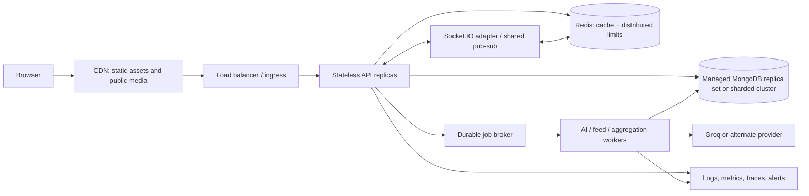

# Parts 7–9: Scale, Security, And Performance

## Part 7: Scalability And System Design

User counts are not capacity measurements. The stages below are planning scenarios, not claims that the current deployment was tested at those sizes.

### Growth Stages

| Stage | Likely behavior of current design | First actions (proposed) |
|---|---|---|
| **100 users** | A single API process and MongoDB can likely support a small demo workload, but no benchmark proves this. | Configure secrets correctly; secure the reader trust boundary; basic tests, backups, logs, and dependency checks. |
| **10,000 users** | Feed/detail queries and AI requests begin competing for DB/provider capacity; process-local limits vary per replica; post counters and poll arrays become hot. | Instrument latency and Mongo explain; cap payloads; cursor feed; route-specific rate limits; durable AI queue; atomic votes. |
| **100,000 users** | Two fixed replicas may help stateless request throughput, but Socket.IO rooms and in-memory rate limits split by pod; Mongo write hotspots and repeated view writes become bottlenecks. | Shared Socket.IO adapter/limiter; managed replicated MongoDB; read caching with versioned invalidation; separate high-volume vote data. |
| **1 million users** | User arrays for followers/bookmarks and embedded voter arrays risk large documents; personalized feed fanout/query cost and provider quotas become material. | Move relationships/actions to edge collections; evaluate feed fanout strategy; CDN static/media; workers and queues; capacity/load tests; monitor data size and hot keys. |
| **10 million users** | A single document database cluster and one monolithic feed strategy may no longer satisfy availability, geographic latency, or write throughput goals. This cannot be asserted without workload data. | Partition by measured access patterns; shard only with a carefully selected key; consider regional strategy, event pipelines, service boundaries where team/scale justify them. Maintain backup/restore and incident operations. |

### Proposed Scale Architecture (Not Implemented)



### Scaling Concepts Applied To Inkwell

- **Load balancing:** EKS ALB ingress routes to services, but current EKS backend replicas are fixed at two; no HPA is evidenced. Scaling replicas increases API capacity only if shared dependencies and per-process state are addressed.
- **Stateless services:** REST API state is mostly in MongoDB/JWT, but sockets, default in-memory limiter, and AI dedup state are process-local. Externalize shared state before scaling horizontally.
- **Caching:** Cache only stable public post projections. Include content version/updated timestamp and invalidate on edit/archive/metadata update. Don't cache per-user `isLiked`/`isBookmarked` alongside public payloads. Redis is a proposal; it is not a current dependency.
- **Database replication:** Use managed replicas for availability and read capacity after measuring. Replicas do not make hot-document writes disappear; stale reads and failover behavior need design.
- **Sharding/consistent hashing:** Shard only after identifying the dominant query and cardinality. A shard key should distribute writes while supporting targeted queries; a poor key causes hotspots or scatter-gather. Consistent hashing is a mechanism, not a default fix.
- **CDN:** Serve static frontend and uploaded media close to users. Current image blocks reference a URL; no media upload/object-storage pipeline is evidenced.
- **Queue/workers:** Move AI metadata generation, comment ranking, and expensive enrichment to durable workers with idempotency, limited concurrency, retries, dead-letter handling, and job status.
- **Microservices:** Keep a modular monolith until separate scaling/ownership/failure boundaries justify extraction. AI is a candidate due to external latency and cost, but extraction adds network and deployment complexity.
- **Fault tolerance:** Timeouts, bounded retries, circuit breakers, durable jobs, graceful shutdown, health/readiness semantics, tested backups, and dependency failure policies are not fully evidenced.
- **Monitoring:** Add request latency/error-rate metrics, DB pool/query timings, queue lag, provider latency/cost, socket counts, resource saturation, and structured logs. No Prometheus, tracing, or load-test config was found.
- **Cost control:** Cap AI input/output and per-user usage; use immutable container tags; scale workers independently; use CDN and cache for repeat reads; measure database egress and idle EKS/NAT cost.

### Failure Scenarios To Explain In A Design Interview

- **AI provider unavailable:** publish still returns; heuristic metadata can be produced, but background failure state and retry visibility are weak. A worker queue plus provider circuit breaker is proposed.
- **Mongo unavailable at startup:** current process exits without listening. During runtime health endpoint may still return ok even if DB access is unhealthy; add readiness/dependency health and graceful behavior.
- **One API replica dies:** Kubernetes can replace it; in-flight local AI tasks are lost, sockets reconnect, and in-memory limiter state resets.
- **Poll event emit failure:** saved vote remains canonical; clients should refetch. To guarantee eventual event publication, use transactional outbox or a repairable publication mechanism.
- **Two pods process same metadata:** local dedupe cannot coordinate. Use durable unique job key based on post/version and worker lease/idempotent result application.
- **Mongo write conflict under popularity:** atomics and separated vote records reduce whole-document contention; monitor write latency and document sizes.

## Part 8: Security Deep Dive

Severity reflects code evidence and potential impact, not a formal penetration test. No exploitation was performed.

| Finding | Evidence and impact | Fix and interview explanation |
|---|---|---|
| **Stored HTML injection / XSS risk (high)** | `BlockRenderer.jsx` sends `block.content`, heading content, and callout text to `dangerouslySetInnerHTML`. Post creation accepts block content. If untrusted markup reaches the reader, it can execute script in the site's origin and perform actions as the user, although the HttpOnly JWT itself is not readable by script. | Prefer render escaped text/React elements. If rich HTML is required, sanitize on a defined server/client boundary with a strict allowlist, disallow scripts/event attributes/javascript URLs, and add CSP. “I treat all user content as untrusted and encode by default; sanitization is only for the explicitly allowed markup subset.” |
| **Runnable code executes in reader origin (critical design risk)** | `BlockRenderer.jsx` runs `new Function(block.code?.source)()` after a reader clicks Run. This is same-page JavaScript execution, not a sandbox. The browser page has access to application context/storage. | Remove execution or execute in a separately-originated, tightly sandboxed iframe with minimal permissions and message-based I/O; ideally use a remote isolated execution service with CPU/memory/time limits. Do not rely on a language label or `runnable` checkbox as safety. |
| **Predictable JWT secret fallback (high)** | `middleware/auth.js` falls back to literal `inkwell-secret-change-in-prod`; Compose also has a default JWT value. Missing env can allow tokens signed with known key to be accepted. | Fail startup in production without a secret; inject via managed secret store; rotate keys and invalidate tokens. Never commit actual secret values. |
| **CORS allowlist configuration (medium)** | CORS now rejects browser origins unless they exactly match configured `FRONTEND_URL` entries. An empty allowlist blocks browser-origin requests; absent-Origin non-browser requests are handled separately and still need authentication/rate limits. CORS is not authentication. | Configure exact origins per environment, test credentialed requests, and avoid reintroducing broad preview suffixes. |
| **HttpOnly JWT cookie (implemented; configuration still matters)** | JWT is set in `inkwell_session` with HttpOnly, SameSite, and Secure in production; frontend no longer reads or stores it. Since cookies are ambient, unsafe requests are checked against allowed Origin. | Keep origins exact, configure `AUTH_COOKIE_SAME_SITE` to deployment topology, retain CSRF checks, and test credentialed CORS in staging. HttpOnly reduces direct token theft but does not prevent injected code from acting as the user. |
| **Weak/uneven validation (medium)** | Poll and quiz handlers do not validate selected option index; post route accepts flexible body; comment creation accepts `parentId` without checking its relation or depth. Invalid states or unauthorized relationships may be persisted. | Validate request DTOs and reference ownership; enforce integer/range checks and max block/option counts; normalize error responses; add tests at route boundaries. |
| **Comment integrity/authorization gaps (plausible, code-backed)** | `POST /comments/post/:postId` creates with client `postId` and `parentId`; it does not load/verify the post or parent relation/depth. This permits orphan or cross-post reply records if IDs are supplied. | Verify target post is published/visible and parent belongs to same post, enforce max depth, and decide whether authors may comment on archived posts. |
| **Rate limits not distributed / no dedicated AI quota (medium)** | One global 500/15-minute express-rate-limit middleware uses default in-memory behavior. Multiple pods get independent counters; AI can be more expensive than regular reads. | Use a shared Redis store in multi-replica deployments, route-specific per-user/IP quotas, bounded body/token sizes, and provider spend alerts. Configure trusted proxy handling carefully. |
| **NoSQL injection** | Search constructs regex after escaping regex metacharacters and uses server-controlled query shape; no raw user-supplied Mongo filter object found in inspected routes. Do not claim confirmed injection from the current evidence. Other routes should still reject unexpected object-shaped values. | Validate primitive types, never pass arbitrary request objects as Mongo filters, allowlist query operators, and test malformed nested payloads. |
| **Secrets/deployment configuration** | `.env.example` documents placeholders, Compose includes an unsafe default, and Kubernetes combined manifest has placeholder secret values. Root `secret.yaml` is ignored and was not inspected. | Use external secret manager / sealed secrets, prevent default credentials in production, restrict IAM/RBAC, rotate keys, and keep ignored local secret files out of artifacts. |
| **Transport/deployment exposure** | ALB ingress annotations indicate HTTP port 80 in inspected config; EC2 setup config serves frontend over HTTP and no TLS setup was evident. | Terminate TLS at ALB or managed proxy, redirect HTTP to HTTPS, use secure cookies if applicable, and set HSTS after confirming HTTPS. |
| **Dependency risk (unverified)** | Package manifests declare versions, but no audit report or lockfile vulnerability assessment was performed. Cannot claim a known CVE from this repository review. | Run `npm audit` or an approved scanner, update deliberately, pin lockfiles, use image scanning/SBOM, and retest. |

**CSRF:** The frontend uses an ambient HttpOnly cookie. Unsafe requests with an unconfigured Origin are rejected; cookie-authenticated unsafe requests without Origin are also rejected. SameSite defaults to Lax. Configure `AUTH_COOKIE_SAME_SITE=none` only for genuinely cross-site frontend/API deployment, over HTTPS, with exact `FRONTEND_URL` allowlisting. No OAuth flow is present in inspected auth routes; do not claim OAuth security controls.

**Exact validation example (proposed):**

```js
const index = Number(req.body.optionIndex);
if (!Number.isInteger(index) || index < 0 || index >= block.poll.options.length) {
  return res.status(400).json({ error: 'Invalid poll option' });
}
```

This belongs after loading and locating the block, before mutating any counts. Equivalent validation is needed for quiz `selectedIndex`.

## Part 9: Performance Optimization

No actual measurements or benchmark suite were found. The ranking below is based on likely hot paths and code behavior; measure before prioritizing production work.

| Rank | Bottleneck and root cause | Proposal and trade-off | How to benchmark |
|---|---|---|---|
| 1 | **Post detail write amplification:** every detail GET performs a separate view `$inc`. Read traffic therefore creates write load. | Batch/stream view events or use approximate counters; counters become eventually consistent and need reconciliation. | Load-test GET detail with realistic mix; compare DB write ops, p95 latency, and counter freshness before/after. |
| 2 | **Hot post documents:** poll, like, quiz aggregate changes load/save the whole document; voter arrays grow. | Atomic conditional updates or separate action records/aggregates. More collections/aggregation and eventual consistency may result. | Concurrent vote/like test; measure conflict/lost-update rate, write latency, document bytes, and DB CPU. |
| 3 | **Offset feed pagination + counts:** posts listing runs `countDocuments` and `.skip`; personalized feed also skip-pages. Deep offsets scan more records. | Cursor pagination and optionally avoid exact total count. API/client navigation changes; counts may be approximate. | Seed large realistic dataset; compare `explain` docsExamined, execution time, and p95 at page depths. |
| 4 | **AI jobs in API process:** unbounded/duplicated external calls compete for connections and provider quota; tasks vanish at restart. | Durable queue and worker concurrency limits; more infrastructure and operational state. | Replay burst publishing; measure queue lag, publish p95, provider concurrency/cost, completion and retry rates. |
| 5 | **Search regex scans:** escaped case-insensitive regex across titles/tags and user/topic fields may scan many docs; visibility filter also references absent field. | Fix visibility semantics first; use text/search index suitable for requirements or dedicated search service if needed. Search index adds memory/update costs and different matching semantics. | Query explain and corpus-size scaling; compare recall/latency and index size for representative terms. |

Additional opportunities: limit populated fields, lazy-load large comments, virtualize long block lists if profiling shows DOM cost, use image CDN/responsive images, and avoid re-rendering the entire editor when one block changes. These are proposals, not measured optimizations.
